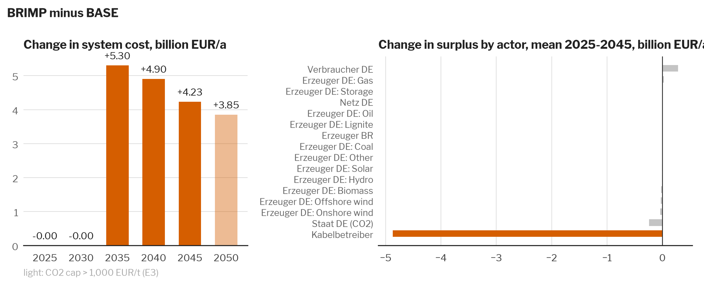
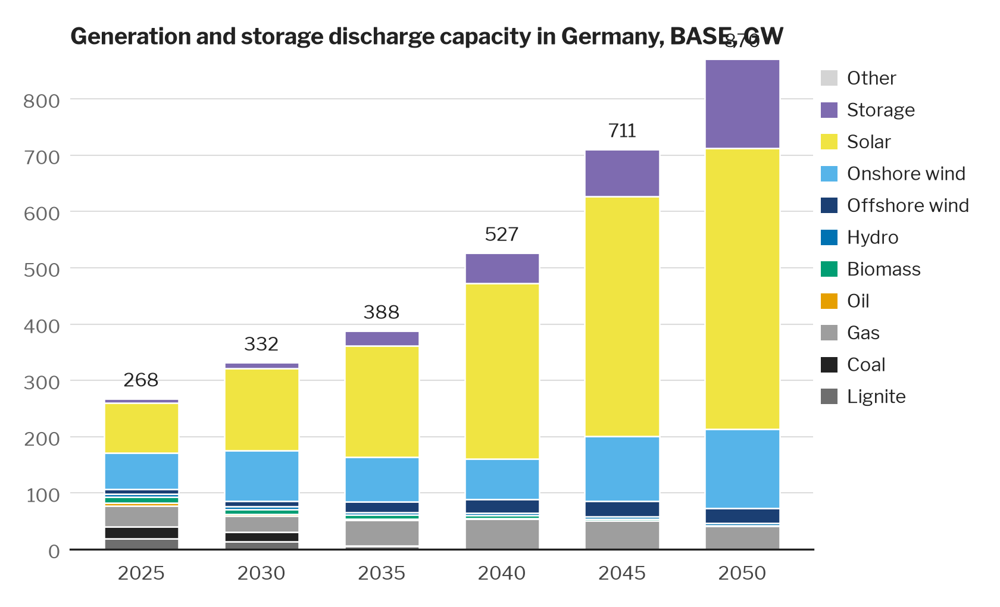
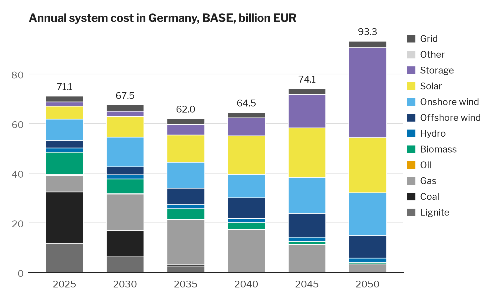
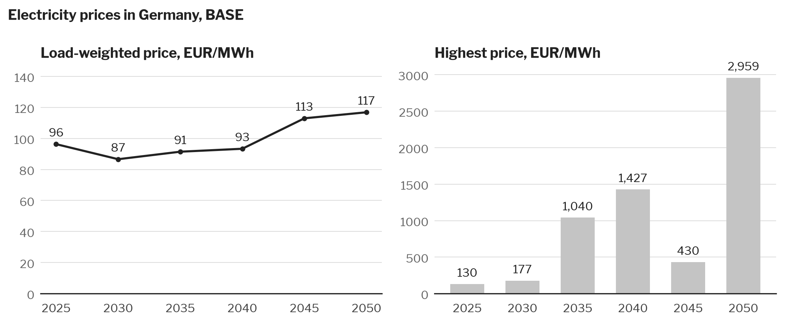
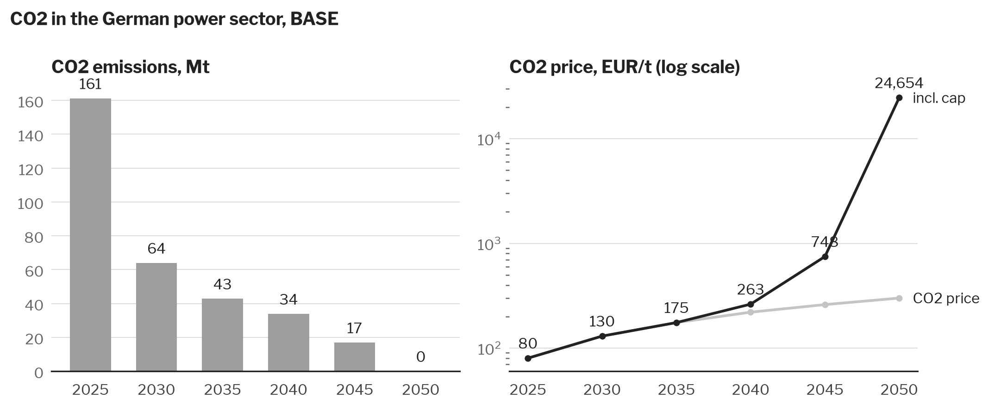
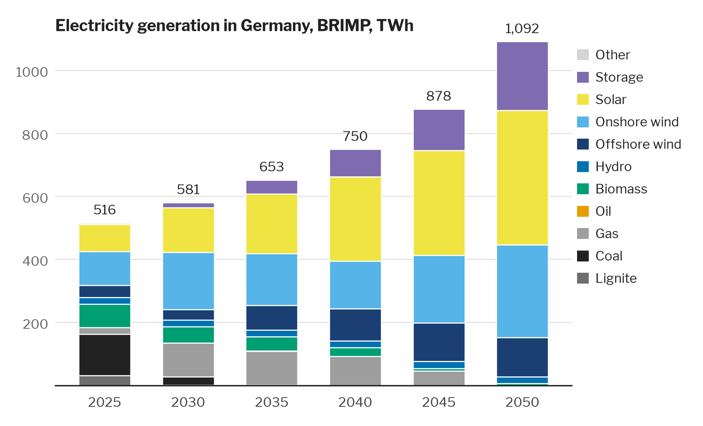
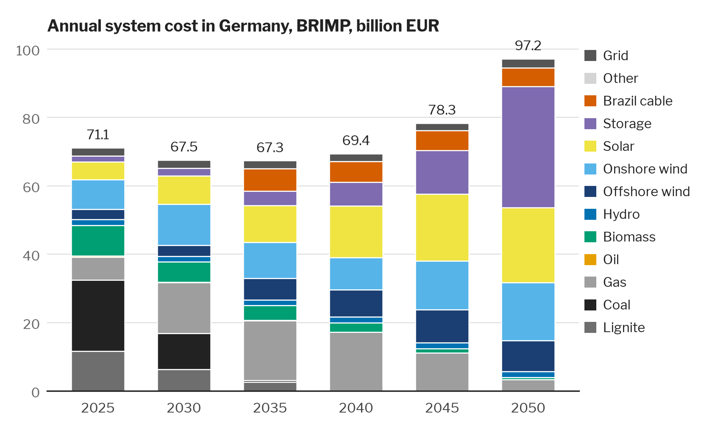
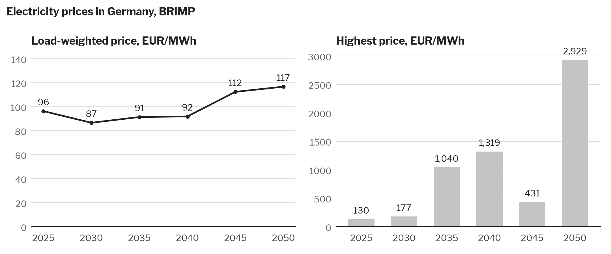
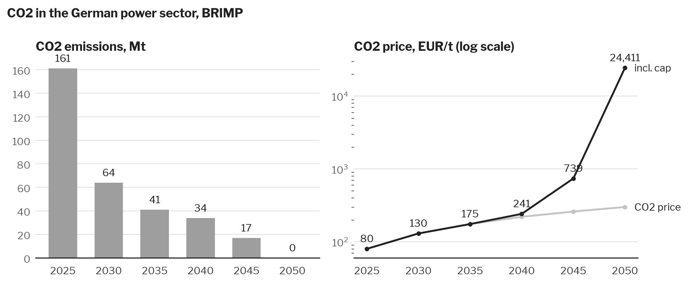

<!--
SPDX-FileCopyrightText: Contributors to PyPSA-Eur <https://github.com/pypsa/pypsa-eur>

SPDX-License-Identifier: CC-BY-4.0
-->

# Ergebnisse der Studie: Kabel Brasilien–Deutschland

Erzeugt von `workshop/analysis/evaluate.py` am 2026-11-27 11:08, Commit 86e70ef6. Nicht von Hand ändern: Die Datei wird bei jedem Lauf neu geschrieben. Befunde und Deutung stehen in `workshop/results/notes.md` und werden unten eingebunden.

Studiendesign, Parameter und Szenarien: `workshop/decisions.md`. Nur öffentliche Modellergebnisse; keine Daten aus `workshop/inputs/` (E7).

## Inhalt

1. [Status der Läufe](#1-status-der-läufe)
2. [Befunde](#2-befunde)
3. [Auffälligkeiten](#3-auffälligkeiten)
4. [Vergleiche](#4-vergleiche)
5. [Ergebnisse je Lauf](#5-ergebnisse-je-lauf)
6. [Definitionen](#6-definitionen)
7. [Dateien](#7-dateien)

## 1. Status der Läufe

| Lauf | Run-Name | Status | Jahre | Solver | Spitzenspeicher (GB) | Beschreibung |
|---|---|---|---|---|---|---|
| BASE | `de10-myopic` | fertig | 2025, 2030, 2035, 2040, 2045, 2050 | Imprecise, Optimal | 6.7 | Workshop baseline, Germany as an island, hard zero CO2 cap in 2050 |
| BRIMP | `de10-br-import` | fertig | 2025, 2030, 2035, 2040, 2045, 2050 | Optimal | 6.6 | Test run, not in E4: BASE + fixed 2 GW Brazil cable from 2035 (CBA of a given cable) |
| REF | `de10-ref` | geplant | – | – | – | Trade with neighbours, soft CO2 cap 2050, no cable |
| CABLE | `de10-cable` | geplant | – | – | – | REF + Brazil cable extendable from 2035, WACC per E2 (main run) |
| MV | `de10-mv` | geplant | – | – | – | CABLE with the cable forced to 0.1 GW (marginal value) |
| CAPEX50 | `de10-capex50` | geplant | – | – | – | CABLE with 50 % cable investment cost |
| WACC7 | `de10-wacc7` | geplant | – | – | – | CABLE with 7 % WACC for Brazil and the cable |
| REF-ISL | `de10-ref-isl` | geplant | – | – | – | REF without trade |
| CABLE-ISL | `de10-cable-isl` | geplant | – | – | – | CABLE without trade |

## 2. Befunde

### Baseline (BASE, `de10-myopic`)

Stand 2026-11-27. Befunde von Hand, Zahlen aus den Tabellen unten.

- **Die Baseline taugt nicht als Vergleichsfall für das Kabel.** 2050 legt die
  CO2-Obergrenze 24.354 EUR/t auf den CO2-Preis, der höchste Strompreis liegt bei
  2.959 EUR/MWh (76 h über 1.000 EUR/MWh). Jede saubere Stromquelle sähe dagegen
  wertvoll aus. Deshalb vergleicht die Studie mit REF (E3, E4), nicht mit BASE.
- **Schon 2035 und 2040 gibt es Preisspitzen** über 1.000 EUR/MWh (32 bzw. 42 h).
  Ursache ist die Insellage: Knappheit, die Handel decken würde, fällt auf Speicher
  und Reservekraftwerke. Ein Kabel bekäme hier einen Wert, der mit Handel (REF)
  kleiner ausfallen dürfte.
- **2045 ist die Obergrenze bereits bindend** (488 EUR/t zusätzlich, effektiv 748 EUR/t).
  Das Ergebnis 2045 ist damit ebenfalls teilweise cap-getrieben; E3 entschärft nur 2050.
- **Speicher wachsen stark:** Kapitalkosten der Speicher von 7 (2040) auf
  36 Mrd EUR/a (2050), davon 72 TWh Wasserstoffspeicher 2050. Das ist der Kostenblock,
  den ein Kabel oder Handel am ehesten ersetzt.
- **Abregelung** von Wind, Solar und Laufwasser steigt auf 159 TWh (2045) und
  107 TWh (2050): Ein Kabel nach Deutschland konkurriert mit billigem Überschussstrom
  in vielen Stunden; sein Wert liegt in den knappen Stunden.
- **Verteilung:** Verbraucher zahlen 49 (2025) bis 89 Mrd EUR/a (2050). Die
  Erzeuger fossiler Anlagen verlieren bis 2035 deutlich (Bestand wird nicht mehr
  gedeckt), Wind und Wasser gewinnen ab 2045.
- **Solver:** 2045 endet "imprecise" (laut BASELINE.md nutzbar); Spitzenspeicher
  6,7 GB von 8 GB, also wenig Luft für mehr Nachbarländer (O4).

### Test: fester 2-GW-Kabel auf der Baseline (BRIMP − BASE, `de10-br-import`)

Stand 2026-11-27. Kein Studienergebnis: BRIMP baut auf BASE (Insel, harter
Nullcap 2050) und gehört nicht zu E4. Er testet Pipeline und Regeln.

- **Ein festes 2-GW-Kabel rechnet sich hier in keinem Jahr.** Die Systemkosten
  steigen um 3,9 bis 5,3 Mrd EUR/a (Mittel 2035–2045: +4,8). Das Kabel kostet
  2,6–3,0 Tsd. EUR/kW/a Annuität bei 10 % WACC, verdient aber nur 0,35–0,57 Tsd.
  EUR/kW/a Engpasserlös: Die Erlöse decken 12–21 % der Kosten.
- **Treiber sind die Kosten der Leitung:** rund 9.500 km (Großkreis × 1,25),
  78,5 % Wirkungsgrad. Das Kabel kostet 2035 6,0 Mrd EUR/a; Deutschland spart dafür
  nur 1,2 Mrd EUR/a an eigenen Kosten.
- **Die Auslastung fällt von 65 % (2035) auf 34 % (2045)**, weil Deutschland
  selbst immer mehr billigen Überschussstrom hat (Stunden mit Preis < 1 EUR/MWh).
  Der Engpasserlös pro kW steigt trotzdem, weil die wenigen knappen Stunden teurer
  werden.
- **2050 verzerrt nicht einmal zugunsten des Kabels:** Der Schattenpreis der
  Obergrenze sinkt nur um 243 von 24.354 EUR/t; die 2 GW bewegen den Nullcap kaum.
  Das Jahr ist trotzdem gekennzeichnet und in der Zusammenfassung ausgelassen.
- **Gewinner und Verlierer** (Mittel 2035–2045): Verbraucher DE +0,5 Mrd EUR/a
  durch etwas niedrigere Preise; der Kabelbetreiber −4,9; der Staat −0,4 (weniger
  CO2-Erlöse). Die Erzeuger in BR stehen bei 0, weil der Importpreis im Modell
  gleich ihren Kosten ist (LCOE, `brazil_import.price`).
- **Abgleich:** Systemkosten, Kabelannuität, Engpasserlös, Lieferung, Auslastung
  und Preis stimmen in allen Jahren mit `workshop/cba/cba_brazil_import.py`
  überein (Abweichung < 0,001); Kabelannuität, Lieferung und Engpasserlös 2040
  direkt aus dem Netz nachgerechnet.
- **Was das für die Studie heißt:** Für die Kapazitätsausbau-Läufe (E1) ist zu
  erwarten, dass das Modell das Kabel nicht baut. Der Abstand zum Break-even
  liegt hier bei rund 2,1–2,7 Tsd. EUR/kW/a; MV und CAPEX50 (E5) messen ihn mit
  Handel genauer.

## 3. Auffälligkeiten

Automatisch geprüft (Schwellen in `evaluate.py`).

- BASE 2045: Solverstatus **Imprecise** (BASELINE.md: imprecise ist nutzbar)
- BASE 2035: Höchster Strompreis 1,040 EUR/MWh
- BASE 2040: Höchster Strompreis 1,427 EUR/MWh
- BASE 2050: Höchster Strompreis 2,959 EUR/MWh
- BASE 2050: Die CO2-Obergrenze kostet 24,354 EUR/t zusätzlich: Ergebnis ist cap-getrieben (README, E3)
- BRIMP 2035: Höchster Strompreis 1,040 EUR/MWh
- BRIMP 2040: Höchster Strompreis 1,319 EUR/MWh
- BRIMP 2050: Höchster Strompreis 2,929 EUR/MWh
- BRIMP 2050: Die CO2-Obergrenze kostet 24,111 EUR/t zusätzlich: Ergebnis ist cap-getrieben (README, E3)

## 4. Vergleiche

### BRIMP − BASE

- **BRIMP**: Test run, not in E4: BASE + fixed 2 GW Brazil cable from 2035 (CBA of a given cable)
- **BASE**: Workshop baseline, Germany as an island, hard zero CO2 cap in 2050

| Zusammenfassung | Δ Systemkosten, Mittel (Mrd EUR/a) | Δ Systemkosten, Summe der Jahre (Mrd EUR/a) |
|---|---|---|
| alle Jahre | +3.05 | +18.29 |
| ohne 2050 (cap-getrieben, E3) | +2.89 | +14.44 |

Negativ = der Lauf ist billiger als die Referenz. Jedes Jahr ist ein Stichjahr (ein Jahr Betrieb), kein Barwert.

| Differenz | 2025 | 2030 | 2035 | 2040 | 2045 | 2050 |
|---|---|---|---|---|---|---|
| Akteure: Erzeuger DE: Biomass (Mrd EUR/a) | -0.00 | +0.00 | -0.01 | -0.08 | -0.02 | -0.00 |
| Akteure: Erzeuger DE: Coal (Mrd EUR/a) | -0.00 | -0.00 | +0.00 |  |  |  |
| Akteure: Erzeuger DE: Gas (Mrd EUR/a) | -0.00 | -0.00 | -0.01 | -0.01 | +0.16 | +0.12 |
| Akteure: Erzeuger DE: Hydro (Mrd EUR/a) | +0.00 | +0.00 | -0.00 | -0.03 | -0.01 | -0.01 |
| Akteure: Erzeuger DE: Lignite (Mrd EUR/a) | +0.00 | +0.00 | +0.00 | +0.00 | -0.00 | +0.00 |
| Akteure: Erzeuger DE: Offshore wind (Mrd EUR/a) | +0.00 | +0.00 | +0.00 | -0.02 | -0.14 | -0.07 |
| Akteure: Erzeuger DE: Oil (Mrd EUR/a) | -0.00 | +0.00 | +0.00 | +0.00 | -0.00 | +0.00 |
| Akteure: Erzeuger DE: Onshore wind (Mrd EUR/a) | +0.00 | +0.00 | -0.01 | -0.07 | -0.12 | -0.02 |
| Akteure: Erzeuger DE: Other (Mrd EUR/a) | +0.00 | +0.00 | -0.00 | -0.00 | -0.00 |  |
| Akteure: Erzeuger DE: Solar (Mrd EUR/a) | -0.00 | -0.00 | -0.02 | +0.02 | -0.02 | +0.03 |
| Akteure: Erzeuger DE: Storage (Mrd EUR/a) | +0.00 | +0.00 | -0.00 | -0.01 | +0.04 | +0.12 |
| Akteure: Netz DE (Mrd EUR/a) | -0.00 | +0.00 | +0.02 | +0.01 | -0.02 | -0.01 |
| Akteure: Staat DE (CO2) (Mrd EUR/a) | -0.00 | -0.00 | -0.32 | -0.72 | -0.16 | +0.00 |
| Akteure: Summe aller Akteure (Mrd EUR/a) | +0.00 | -0.00 | -5.62 | -4.90 | -4.23 | -3.85 |
| Akteure: Verbraucher DE (Mrd EUR/a) | +0.00 | -0.00 | +0.03 | +0.96 | +0.41 | +0.13 |
| Akteure: Erzeuger BR (Mrd EUR/a) |  |  | +0.00 | +0.00 | +0.00 | +0.00 |
| Akteure: Kabelbetreiber (Mrd EUR/a) |  |  | -5.31 | -4.97 | -4.35 | -4.16 |
| CO2: CO2-Preis (Config) (EUR/t) | +0.00 | +0.00 | +0.00 | +0.00 | +0.00 | +0.00 |
| CO2: CO2-Preis effektiv (EUR/t) | +0.00 | +0.00 | +0.00 | -21.23 | -9.36 | -243.48 |
| CO2: Emissionen (Mt) | -0.00 | -0.00 | -1.84 | -0.00 | +0.00 | +0.00 |
| CO2: Obergrenze (Mt) | +0.00 | +0.00 | +0.00 | +0.00 | +0.00 | +0.00 |
| CO2: Schattenpreis der Obergrenze (EUR/t) | +0.00 | +0.00 | +0.00 | -21.23 | -9.36 | -243.48 |
| Handel: Export brutto (TWh) | +0.00 | +0.00 | +0.00 | +0.00 | +0.00 | +0.00 |
| Handel: Import brutto (TWh) | +0.00 | +0.00 | +0.00 | +0.00 | +0.00 | +0.00 |
| Handel: Netto-Import (TWh) | +0.00 | +0.00 | +0.00 | +0.00 | +0.00 | +0.00 |
| Preise: Strompreis Maximum (EUR/MWh) | +0.00 | +0.00 | +0.28 | -107.96 | +0.81 | -29.22 |
| Preise: Strompreis Mittel (EUR/MWh) | -0.00 | +0.00 | -0.07 | -1.36 | -0.47 | -0.24 |
| Preise: Strompreis lastgewichtet (EUR/MWh) | -0.00 | +0.00 | -0.05 | -1.46 | -0.58 | -0.17 |
| Preise: Stunden mit Preis < 1 EUR/MWh (h) | +0.00 | -2.00 | -36.00 | -216.00 | -124.00 | -14.00 |
| Preise: Stunden mit Preis > 1000 EUR/MWh (h) | +0.00 | +0.00 | +0.00 | +0.00 | +0.00 | +60.00 |
| Systemkosten: Systemkosten gesamt (Mrd EUR/a) | -0.00 | -0.00 | +5.30 | +4.90 | +4.23 | +3.85 |
| Systemkosten: davon Betriebskosten (Mrd EUR/a) | -0.00 | -0.00 | -0.11 | +0.42 | +0.24 | +0.23 |
| Systemkosten: davon CO2-Preis (Transfer an den Staat) (Mrd EUR/a) | -0.00 | -0.00 | -0.32 | -0.00 | +0.00 | +0.00 |
| Systemkosten: davon Kapitalkosten (Mrd EUR/a) | +0.00 | +0.00 | +5.41 | +4.48 | +3.99 | +3.63 |
| Kabel: Abstand zum Break-even pro kW (EUR/kW/a) |  |  | -2,652.66 | -2,482.47 | -2,174.53 | -2,079.08 |
| Kabel: Annuität inkl. FOM (Mrd EUR/a) |  |  | +6.00 | +5.73 | +5.48 | +5.21 |
| Kabel: Annuität pro kW (EUR/kW/a) |  |  | +3,000.58 | +2,865.44 | +2,739.73 | +2,604.47 |
| Kabel: Auslastung (%) |  |  | +64.95 | +55.61 | +34.10 | +33.53 |
| Kabel: Engpasserlös (Mrd EUR/a) |  |  | +0.70 | +0.77 | +1.13 | +1.05 |
| Kabel: Engpasserlös pro kW (EUR/kW/a) |  |  | +347.92 | +382.97 | +565.20 | +525.39 |
| Kabel: Kapazität (GW) |  |  | +2.00 | +2.00 | +2.00 | +2.00 |
| Kabel: Lieferung nach DE (TWh) |  |  | +8.93 | +7.65 | +4.69 | +4.61 |

## 5. Ergebnisse je Lauf

### BASE: Workshop baseline, Germany as an island, hard zero CO2 cap in 2050

#### Nachfrage

| Nachfrage | 2025 | 2030 | 2035 | 2040 | 2045 | 2050 |
|---|---|---|---|---|---|---|
| Stromnachfrage (TWh) | 509.2 | 560.1 | 611.0 | 661.9 | 712.8 | 763.7 |

#### Preise

| Preise | 2025 | 2030 | 2035 | 2040 | 2045 | 2050 |
|---|---|---|---|---|---|---|
| Strompreis lastgewichtet (EUR/MWh) | 96 | 87 | 91 | 93 | 113 | 117 |
| Strompreis Mittel (EUR/MWh) | 95 | 85 | 89 | 90 | 106 | 108 |
| Strompreis Maximum (EUR/MWh) | 130 | 177 | 1,040 | 1,427 | 430 | 2,959 |
| Stunden mit Preis > 1000 EUR/MWh (h) | 0 | 0 | 32 | 42 | 0 | 76 |
| Stunden mit Preis < 1 EUR/MWh (h) | 364 | 2,156 | 2,410 | 3,316 | 4,798 | 3,412 |

#### Erzeugung

| Erzeugung | 2025 | 2030 | 2035 | 2040 | 2045 | 2050 |
|---|---|---|---|---|---|---|
| Lignite (TWh) | 32.4 | 1.5 | 0.7 | 0.0 |  |  |
| Coal (TWh) | 130.7 | 25.8 | 0.2 |  |  |  |
| Gas (TWh) | 21.4 | 108.3 | 113.7 | 92.8 | 46.7 |  |
| Oil (TWh) | 0.0 | 0.0 | 0.1 | 0.0 |  |  |
| Biomass (TWh) | 73.7 | 51.1 | 45.0 | 26.9 | 8.0 | 6.7 |
| Hydro (TWh) | 21.6 | 21.6 | 21.6 | 21.6 | 21.6 | 21.6 |
| Offshore wind (TWh) | 38.4 | 33.4 | 81.5 | 105.0 | 121.2 | 123.4 |
| Onshore wind (TWh) | 107.9 | 180.6 | 164.6 | 150.5 | 218.7 | 299.2 |
| Solar (TWh) | 85.8 | 142.2 | 189.4 | 273.0 | 336.3 | 432.2 |
| Storage (TWh) | 4.3 | 16.3 | 44.9 | 89.5 | 134.7 | 221.7 |
| Other (TWh) | 0.2 | 0.2 | 0.2 | 0.1 | 0.0 |  |
| Abregelung Wind, Solar, Laufwasser (TWh) | 3.0 | 34.1 | 41.8 | 77.6 | 158.6 | 107.1 |

#### Kapazität

| Kapazität | 2025 | 2030 | 2035 | 2040 | 2045 | 2050 |
|---|---|---|---|---|---|---|
| Lignite (GW) | 19.5 | 14.2 | 5.8 | 0.0 | 0.0 | 0.0 |
| Coal (GW) | 20.4 | 16.9 | 1.1 |  |  |  |
| Gas (GW) | 36.9 | 28.4 | 45.1 | 54.0 | 50.4 | 41.1 |
| Oil (GW) | 5.7 | 2.4 | 1.7 | 0.9 | 0.3 | 0.0 |
| Biomass (GW) | 11.1 | 9.5 | 7.9 | 5.4 | 2.7 | 1.3 |
| Hydro (GW) | 4.4 | 4.4 | 4.4 | 4.4 | 4.4 | 4.4 |
| Offshore wind (GW) | 9.2 | 9.6 | 18.9 | 23.7 | 27.7 | 26.0 |
| Onshore wind (GW) | 63.6 | 90.4 | 79.2 | 72.4 | 115.5 | 140.8 |
| Solar (GW) | 89.8 | 145.1 | 197.4 | 311.3 | 425.4 | 499.0 |
| Storage (GW) | 7.4 | 10.6 | 26.5 | 54.4 | 84.3 | 157.7 |
| Other (GW) | 0.0 | 0.0 | 0.0 | 0.0 | 0.0 | 0.0 |

#### Speicher

| Speicher | 2025 | 2030 | 2035 | 2040 | 2045 | 2050 |
|---|---|---|---|---|---|---|
| Batteriespeicher Energie (GWh) | 0.0 | 19.7 | 155.2 | 391.5 | 606.6 | 834.2 |
| Wasserstoffspeicher Energie (TWh) | 0.0 | 0.0 | 0.0 | 0.0 | 12.7 | 72.3 |

#### CO2

| CO2 | 2025 | 2030 | 2035 | 2040 | 2045 | 2050 |
|---|---|---|---|---|---|---|
| Emissionen (Mt) | 161.2 | 64.0 | 42.8 | 33.8 | 16.9 | 0.0 |
| Obergrenze (Mt) | 219.3 | 152.3 | 84.6 | 33.8 | 16.9 | 0.0 |
| CO2-Preis (Config) (EUR/t) | 80.0 | 130.0 | 175.0 | 220.0 | 260.0 | 300.0 |
| Schattenpreis der Obergrenze (EUR/t) | 0.0 | 0.0 | 0.0 | 42.6 | 488.2 | 24,354.4 |
| CO2-Preis effektiv (EUR/t) | 80.0 | 130.0 | 175.0 | 262.6 | 748.2 | 24,654.4 |

#### Systemkosten

| Systemkosten | 2025 | 2030 | 2035 | 2040 | 2045 | 2050 |
|---|---|---|---|---|---|---|
| Systemkosten gesamt (Mrd EUR/a) | 71.1 | 67.5 | 62.0 | 64.5 | 74.1 | 93.3 |
| davon Kapitalkosten (Mrd EUR/a) | 50.8 | 51.1 | 47.2 | 51.6 | 67.2 | 93.1 |
| davon Betriebskosten (Mrd EUR/a) | 20.3 | 16.5 | 14.9 | 12.9 | 6.9 | 0.2 |
| davon CO2-Preis (Transfer an den Staat) (Mrd EUR/a) | 12.9 | 8.3 | 7.5 | 7.4 | 4.4 | 0.0 |

#### Systemkosten nach Gruppe

| Systemkosten nach Gruppe | 2025 | 2030 | 2035 | 2040 | 2045 | 2050 |
|---|---|---|---|---|---|---|
| Biomass (Mrd EUR/a) | 9.0 | 6.0 | 4.3 | 2.7 | 1.3 | 0.6 |
| Coal (Mrd EUR/a) | 20.8 | 10.6 | 0.5 |  |  |  |
| Gas (Mrd EUR/a) | 6.7 | 14.8 | 18.2 | 17.3 | 11.3 | 3.5 |
| Grid (Mrd EUR/a) | 2.4 | 2.4 | 2.3 | 2.2 | 2.2 | 2.6 |
| Hydro (Mrd EUR/a) | 1.7 | 1.7 | 1.7 | 1.7 | 1.7 | 1.7 |
| Lignite (Mrd EUR/a) | 11.7 | 6.3 | 2.6 | 0.0 | 0.0 | 0.0 |
| Offshore wind (Mrd EUR/a) | 3.0 | 3.2 | 6.6 | 8.3 | 9.7 | 9.1 |
| Oil (Mrd EUR/a) | 0.3 | 0.1 | 0.1 | 0.1 | 0.0 | 0.0 |
| Onshore wind (Mrd EUR/a) | 8.6 | 12.0 | 10.5 | 9.5 | 14.5 | 17.3 |
| Other (Mrd EUR/a) | 0.0 | 0.0 | 0.0 | 0.0 | 0.0 |  |
| Solar (Mrd EUR/a) | 5.2 | 8.3 | 10.9 | 15.5 | 19.9 | 22.3 |
| Storage (Mrd EUR/a) | 1.7 | 2.1 | 4.3 | 7.2 | 13.6 | 36.3 |

#### Handel

| Handel | 2025 | 2030 | 2035 | 2040 | 2045 | 2050 |
|---|---|---|---|---|---|---|
| Netto-Import (TWh) | 0.0 | 0.0 | 0.0 | 0.0 | 0.0 | 0.0 |
| Import brutto (TWh) | 0.0 | 0.0 | 0.0 | 0.0 | 0.0 | 0.0 |
| Export brutto (TWh) | 0.0 | 0.0 | 0.0 | 0.0 | 0.0 | 0.0 |

#### Akteure

| Akteure | 2025 | 2030 | 2035 | 2040 | 2045 | 2050 |
|---|---|---|---|---|---|---|
| Erzeuger DE: Biomass (Mrd EUR/a) | -1.4 | -0.1 | 1.4 | 1.4 | 1.1 | 0.5 |
| Erzeuger DE: Coal (Mrd EUR/a) | -6.7 | -6.9 | -0.4 |  |  |  |
| Erzeuger DE: Gas (Mrd EUR/a) | -4.2 | -0.8 | -0.3 | -0.3 | -2.4 | -3.5 |
| Erzeuger DE: Hydro (Mrd EUR/a) | 0.4 | 0.2 | 0.3 | 0.3 | 0.7 | 0.8 |
| Erzeuger DE: Lignite (Mrd EUR/a) | -8.1 | -6.0 | -2.2 | -0.0 | -0.0 | -0.0 |
| Erzeuger DE: Offshore wind (Mrd EUR/a) | 0.3 | -0.4 | -0.4 | -0.5 | 1.4 | 1.4 |
| Erzeuger DE: Oil (Mrd EUR/a) | -0.3 | -0.1 | -0.0 | -0.0 | -0.0 | -0.0 |
| Erzeuger DE: Onshore wind (Mrd EUR/a) | -0.2 | -0.9 | -0.3 | 0.4 | 1.8 | 2.1 |
| Erzeuger DE: Other (Mrd EUR/a) | 0.0 | 0.0 | 0.0 | 0.0 | 0.0 |  |
| Erzeuger DE: Solar (Mrd EUR/a) | 1.6 | -1.5 | -1.7 | -2.6 | -2.3 | -2.5 |
| Erzeuger DE: Storage (Mrd EUR/a) | -1.4 | -0.8 | -0.8 | -1.4 | -1.9 | -3.0 |
| Netz DE (Mrd EUR/a) | -2.0 | -1.9 | -1.8 | -1.4 | -0.2 | 0.1 |
| Verbraucher DE (Mrd EUR/a) | -49.0 | -48.5 | -55.9 | -61.8 | -80.5 | -89.3 |
| Staat DE (CO2) (Mrd EUR/a) | 12.9 | 8.3 | 7.5 | 8.9 | 12.7 | 0.0 |
| Summe aller Akteure (Mrd EUR/a) | -58.2 | -59.2 | -54.5 | -57.1 | -69.7 | -93.3 |

### BRIMP: Test run, not in E4: BASE + fixed 2 GW Brazil cable from 2035 (CBA of a given cable)

#### Nachfrage

| Nachfrage | 2025 | 2030 | 2035 | 2040 | 2045 | 2050 |
|---|---|---|---|---|---|---|
| Stromnachfrage (TWh) | 509.2 | 560.1 | 611.0 | 661.9 | 712.8 | 763.7 |

#### Preise

| Preise | 2025 | 2030 | 2035 | 2040 | 2045 | 2050 |
|---|---|---|---|---|---|---|
| Strompreis lastgewichtet (EUR/MWh) | 96 | 87 | 91 | 92 | 112 | 117 |
| Strompreis Mittel (EUR/MWh) | 95 | 85 | 89 | 88 | 105 | 107 |
| Strompreis Maximum (EUR/MWh) | 130 | 177 | 1,040 | 1,319 | 431 | 2,929 |
| Stunden mit Preis > 1000 EUR/MWh (h) | 0 | 0 | 32 | 42 | 0 | 136 |
| Stunden mit Preis < 1 EUR/MWh (h) | 364 | 2,154 | 2,374 | 3,100 | 4,674 | 3,398 |

#### Erzeugung

| Erzeugung | 2025 | 2030 | 2035 | 2040 | 2045 | 2050 |
|---|---|---|---|---|---|---|
| Lignite (TWh) | 32.4 | 1.5 | 0.7 | 0.0 | 0.0 |  |
| Coal (TWh) | 130.7 | 25.8 | 0.2 |  |  |  |
| Gas (TWh) | 21.4 | 108.3 | 108.5 | 92.4 | 46.5 |  |
| Oil (TWh) | 0.0 | 0.0 | 0.1 | 0.0 | 0.0 |  |
| Biomass (TWh) | 73.7 | 51.1 | 45.5 | 28.5 | 8.2 | 6.7 |
| Hydro (TWh) | 21.6 | 21.6 | 21.6 | 21.6 | 21.6 | 21.6 |
| Offshore wind (TWh) | 38.3 | 33.1 | 77.4 | 101.0 | 122.1 | 123.6 |
| Onshore wind (TWh) | 108.0 | 180.9 | 165.6 | 151.0 | 214.6 | 294.8 |
| Solar (TWh) | 85.8 | 142.2 | 188.5 | 267.7 | 332.7 | 427.3 |
| Storage (TWh) | 4.3 | 16.3 | 44.8 | 87.5 | 131.8 | 217.6 |
| Other (TWh) | 0.2 | 0.2 | 0.2 | 0.1 | 0.0 |  |
| Abregelung Wind, Solar, Laufwasser (TWh) | 3.0 | 34.1 | 39.6 | 69.4 | 153.1 | 105.3 |

#### Kapazität

| Kapazität | 2025 | 2030 | 2035 | 2040 | 2045 | 2050 |
|---|---|---|---|---|---|---|
| Lignite (GW) | 19.5 | 14.2 | 5.8 | 0.0 | 0.0 | 0.0 |
| Coal (GW) | 20.4 | 16.9 | 1.1 |  |  |  |
| Gas (GW) | 36.9 | 28.4 | 43.9 | 53.3 | 49.7 | 40.4 |
| Oil (GW) | 5.7 | 2.4 | 1.7 | 0.9 | 0.3 | 0.0 |
| Biomass (GW) | 11.1 | 9.5 | 7.9 | 5.4 | 2.7 | 1.3 |
| Hydro (GW) | 4.4 | 4.4 | 4.4 | 4.4 | 4.4 | 4.4 |
| Offshore wind (GW) | 9.2 | 9.6 | 18.0 | 22.8 | 27.7 | 26.0 |
| Onshore wind (GW) | 63.6 | 90.4 | 79.2 | 71.5 | 112.9 | 138.5 |
| Solar (GW) | 89.8 | 145.1 | 195.7 | 301.5 | 418.9 | 493.2 |
| Storage (GW) | 7.4 | 10.6 | 26.3 | 52.8 | 81.7 | 155.4 |
| Other (GW) | 0.0 | 0.0 | 0.0 | 0.0 | 0.0 | 0.0 |

#### Speicher

| Speicher | 2025 | 2030 | 2035 | 2040 | 2045 | 2050 |
|---|---|---|---|---|---|---|
| Batteriespeicher Energie (GWh) | 0.0 | 19.7 | 152.1 | 370.1 | 582.9 | 827.8 |
| Wasserstoffspeicher Energie (TWh) | 0.0 | 0.0 | 0.0 | 0.0 | 10.7 | 69.6 |

#### CO2

| CO2 | 2025 | 2030 | 2035 | 2040 | 2045 | 2050 |
|---|---|---|---|---|---|---|
| Emissionen (Mt) | 161.2 | 64.0 | 41.0 | 33.8 | 16.9 | 0.0 |
| Obergrenze (Mt) | 219.3 | 152.3 | 84.6 | 33.8 | 16.9 | 0.0 |
| CO2-Preis (Config) (EUR/t) | 80.0 | 130.0 | 175.0 | 220.0 | 260.0 | 300.0 |
| Schattenpreis der Obergrenze (EUR/t) | 0.0 | 0.0 | 0.0 | 21.4 | 478.9 | 24,110.9 |
| CO2-Preis effektiv (EUR/t) | 80.0 | 130.0 | 175.0 | 241.4 | 738.9 | 24,410.9 |

#### Systemkosten

| Systemkosten | 2025 | 2030 | 2035 | 2040 | 2045 | 2050 |
|---|---|---|---|---|---|---|
| Systemkosten gesamt (Mrd EUR/a) | 71.1 | 67.5 | 67.3 | 69.4 | 78.3 | 97.2 |
| davon Kapitalkosten (Mrd EUR/a) | 50.8 | 51.1 | 52.6 | 56.0 | 71.2 | 96.8 |
| davon Betriebskosten (Mrd EUR/a) | 20.3 | 16.5 | 14.7 | 13.4 | 7.2 | 0.4 |
| davon CO2-Preis (Transfer an den Staat) (Mrd EUR/a) | 12.9 | 8.3 | 7.2 | 7.4 | 4.4 | 0.0 |

#### Systemkosten nach Gruppe

| Systemkosten nach Gruppe | 2025 | 2030 | 2035 | 2040 | 2045 | 2050 |
|---|---|---|---|---|---|---|
| Biomass (Mrd EUR/a) | 9.0 | 6.0 | 4.3 | 2.7 | 1.3 | 0.6 |
| Coal (Mrd EUR/a) | 20.8 | 10.6 | 0.5 |  |  |  |
| Gas (Mrd EUR/a) | 6.7 | 14.8 | 17.5 | 17.2 | 11.1 | 3.3 |
| Grid (Mrd EUR/a) | 2.4 | 2.4 | 2.3 | 2.2 | 2.2 | 2.6 |
| Hydro (Mrd EUR/a) | 1.7 | 1.7 | 1.7 | 1.7 | 1.7 | 1.7 |
| Lignite (Mrd EUR/a) | 11.7 | 6.3 | 2.6 | 0.0 | 0.0 | 0.0 |
| Offshore wind (Mrd EUR/a) | 3.0 | 3.2 | 6.3 | 8.0 | 9.7 | 9.0 |
| Oil (Mrd EUR/a) | 0.3 | 0.1 | 0.1 | 0.1 | 0.0 | 0.0 |
| Onshore wind (Mrd EUR/a) | 8.6 | 12.0 | 10.5 | 9.4 | 14.2 | 17.0 |
| Other (Mrd EUR/a) | 0.0 | 0.0 | 0.0 | 0.0 | 0.0 |  |
| Solar (Mrd EUR/a) | 5.2 | 8.3 | 10.8 | 15.1 | 19.6 | 22.0 |
| Storage (Mrd EUR/a) | 1.7 | 2.1 | 4.3 | 7.0 | 12.8 | 35.4 |
| Brazil cable (Mrd EUR/a) |  |  | 6.5 | 6.1 | 5.7 | 5.4 |

#### Handel

| Handel | 2025 | 2030 | 2035 | 2040 | 2045 | 2050 |
|---|---|---|---|---|---|---|
| Netto-Import (TWh) | 0.0 | 0.0 | 0.0 | 0.0 | 0.0 | 0.0 |
| Import brutto (TWh) | 0.0 | 0.0 | 0.0 | 0.0 | 0.0 | 0.0 |
| Export brutto (TWh) | 0.0 | 0.0 | 0.0 | 0.0 | 0.0 | 0.0 |

#### Akteure

| Akteure | 2025 | 2030 | 2035 | 2040 | 2045 | 2050 |
|---|---|---|---|---|---|---|
| Erzeuger DE: Biomass (Mrd EUR/a) | -1.4 | -0.1 | 1.4 | 1.3 | 1.0 | 0.5 |
| Erzeuger DE: Coal (Mrd EUR/a) | -6.7 | -6.9 | -0.4 |  |  |  |
| Erzeuger DE: Gas (Mrd EUR/a) | -4.2 | -0.8 | -0.3 | -0.3 | -2.2 | -3.3 |
| Erzeuger DE: Hydro (Mrd EUR/a) | 0.4 | 0.2 | 0.3 | 0.3 | 0.6 | 0.8 |
| Erzeuger DE: Lignite (Mrd EUR/a) | -8.1 | -6.0 | -2.2 | -0.0 | -0.0 | -0.0 |
| Erzeuger DE: Offshore wind (Mrd EUR/a) | 0.3 | -0.4 | -0.4 | -0.6 | 1.3 | 1.3 |
| Erzeuger DE: Oil (Mrd EUR/a) | -0.3 | -0.1 | -0.0 | -0.0 | -0.0 | -0.0 |
| Erzeuger DE: Onshore wind (Mrd EUR/a) | -0.2 | -0.9 | -0.3 | 0.3 | 1.7 | 2.1 |
| Erzeuger DE: Other (Mrd EUR/a) | 0.0 | 0.0 | 0.0 | 0.0 | 0.0 |  |
| Erzeuger DE: Solar (Mrd EUR/a) | 1.6 | -1.5 | -1.7 | -2.5 | -2.3 | -2.4 |
| Erzeuger DE: Storage (Mrd EUR/a) | -1.4 | -0.8 | -0.8 | -1.4 | -1.8 | -2.9 |
| Netz DE (Mrd EUR/a) | -2.0 | -1.9 | -1.7 | -1.4 | -0.2 | 0.1 |
| Verbraucher DE (Mrd EUR/a) | -49.0 | -48.5 | -55.8 | -60.8 | -80.1 | -89.1 |
| Staat DE (CO2) (Mrd EUR/a) | 12.9 | 8.3 | 7.2 | 8.2 | 12.5 | 0.0 |
| Summe aller Akteure (Mrd EUR/a) | -58.2 | -59.2 | -60.2 | -62.0 | -73.9 | -97.2 |
| Erzeuger BR (Mrd EUR/a) |  |  | 0.0 | 0.0 | 0.0 | 0.0 |
| Kabelbetreiber (Mrd EUR/a) |  |  | -5.3 | -5.0 | -4.3 | -4.2 |

#### Kabel

| Kabel | 2035 | 2040 | 2045 | 2050 |
|---|---|---|---|---|
| Kapazität (GW) | 2.0 | 2.0 | 2.0 | 2.0 |
| Lieferung nach DE (TWh) | 8.9 | 7.6 | 4.7 | 4.6 |
| Auslastung (%) | 65.0 | 55.6 | 34.1 | 33.5 |
| Engpasserlös (Mrd EUR/a) | 0.7 | 0.8 | 1.1 | 1.1 |
| Annuität inkl. FOM (Mrd EUR/a) | 6.0 | 5.7 | 5.5 | 5.2 |
| Engpasserlös pro kW (EUR/kW/a) | 347.9 | 383.0 | 565.2 | 525.4 |
| Annuität pro kW (EUR/kW/a) | 3,000.6 | 2,865.4 | 2,739.7 | 2,604.5 |
| Abstand zum Break-even pro kW (EUR/kW/a) | -2,652.7 | -2,482.5 | -2,174.5 | -2,079.1 |

## 6. Definitionen

- **Deutschland**: alle AC-Knoten mit `country == DE`. Erzeugung, Kapazität, Preise, Emissionen und Akteure beziehen sich darauf; Systemkosten auf das ganze Modell.
- **Systemkosten**: Kapitalkosten (Annuität inkl. FOM aller aktiven Anlagen, auch Bestand) + Betriebskosten (inkl. CO2-Preis) eines Jahres, `n.statistics.capex()` + `opex()`. In Differenzen heben sich die Bestandsanlagen auf. Die Zielfunktion des Solvers ist kleiner: Bei myopic stehen die Kapitalkosten des Bestands dort nicht drin.
- **Strompreis lastgewichtet**: Σ Last × Knotenpreis / Σ Last.
- **Kapazität**: Generatoren und Speicher am deutschen AC-Netz; Batterie und Brennstoffzelle als Entladeleistung.
- **CO2-Preis effektiv**: CO2-Preis aus der Config + Schattenpreis der CO2-Obergrenze.
- **Netto-Import**: Fluss über grenzüberschreitende Leitungen nach Deutschland, ohne das Kabel.
- **Kabel**: Link mit Carrier „Brazil HVDC“. Engpasserlös = Σ (Preis DE × Lieferung − Preis BR × Einspeisung); Abstand zum Break-even = Engpasserlös pro kW − Annuität pro kW (E5).
- **Akteure** (E6): je Akteur Erlöse − Kapitalkosten − Betriebskosten. Verbraucher: −Zahlungen. Emittenten zahlen den CO2-Preis und den Schattenpreis der Obergrenze an den Staat (als ob Zertifikate versteigert würden). CO2-Zahlungen sind Transfers zwischen Akteuren: Die Summe aller Akteure = −(Systemkosten − CO2-Preis-Zahlungen). In Differenzen zweier Läufe ist das der Wohlfahrtsgewinn ohne CO2-Bewertung; die Emissionsänderung steht getrennt unter CO2.

## 7. Dateien

| Datei | Inhalt |
|---|---|
| `metrics.csv` | alle Kennzahlen, lang: run, horizon, section, metric, unit, value |
| `comparisons.csv` | Differenzen run − reference, gleiche Spalten + reference |
| `status.csv` | Solverstatus, Lösezeit und Spitzenspeicher je Lauf und Jahr |
| `figures/` | Abbildungen als PNG (300 dpi) und PDF |
| `notes.md` | Befunde und Deutung, von Hand gepflegt |
